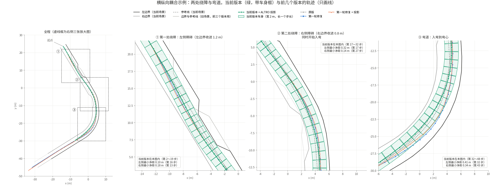
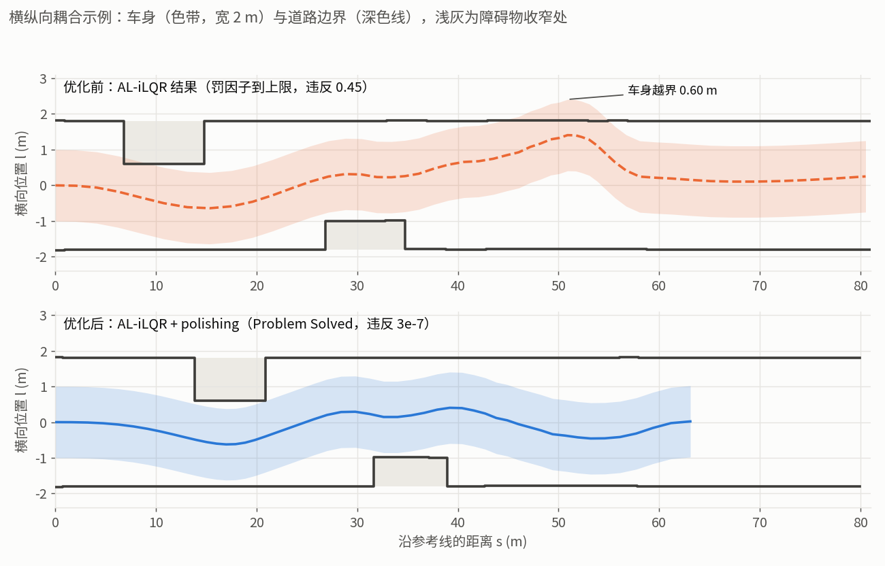
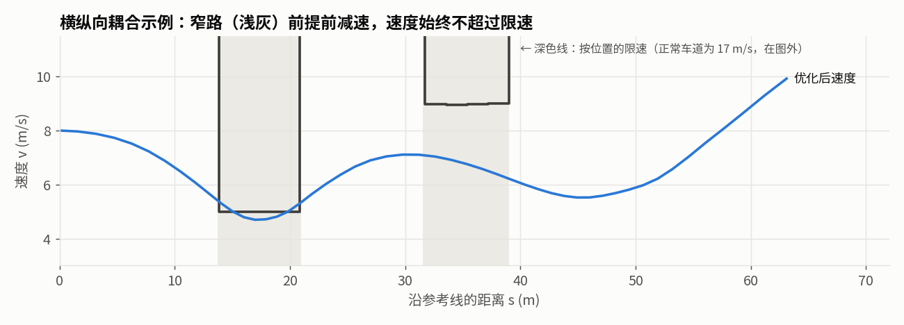
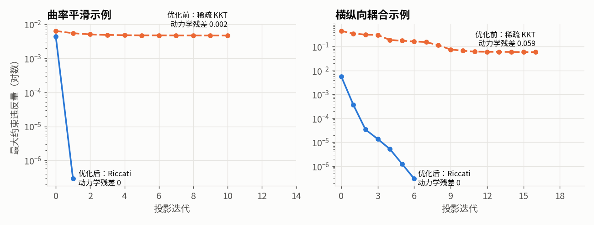
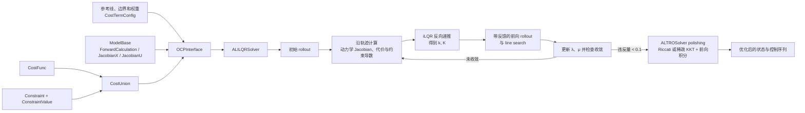

# AL-iLQR / ALTRO 轨迹优化实验实现

这是一个使用 C++17 和 Eigen 编写的实验性轨迹优化项目，实现了以下两个逐步演进的求解流程：

- **AL-iLQR**：在 iLQR 上加入增广拉格朗日（Augmented Lagrangian, AL）机制，以处理一般的状态与控制约束；
- **ALTRO 风格的 solution polishing**：先以 AL-iLQR 获得动力学可行的解，再对激活约束做目标函数加权的投影修正，以进一步降低约束违反量。

项目最初配套于知乎文章[《一种 AL-iLQR 的框架实现和应用》](https://zhuanlan.zhihu.com/p/703259867)。仓库保留了开发过程中的两个代码快照：当前的 `altro_fix/` 是推荐阅读和运行的版本；`alilqr/` 是较早期的实现，主要用于回溯架构演进。

> [!WARNING]
> 这是研究与原型代码，而不是已经产品化的通用求解器。示例的参考线、约束参数和权重直接写在源文件中；没有数据加载格式或持续集成测试。使用前请先阅读“限制与已知边界”。

## 能做什么

`altro_fix/` 中有两个车辆轨迹优化示例：

| 目标 | 入口 | 状态与控制 | 离散变量 |
| --- | --- | --- | --- |
| 曲率平滑与道路边界约束 | `main.cpp` | $x=[p_x,p_y,\theta,\kappa,\dot\kappa]$ <br> $u=[\ddot\kappa]$ | 弧长 $ds$ |
| 横纵向耦合的轨迹优化 | `motion_planning/motion_planning.cpp` | $x=[p_x,p_y,\theta,\kappa,v,a]$ <br> $u=[j,\dot\kappa]$ | 时间 $dt$ |

后一个模型覆盖了 jerk、曲率变化率、速度、加速度、向心加速度/jerk、航向误差以及道路安全距离等常见车辆规划项。位置积分使用 10 点 Gauss–Legendre 积分，以减小简单欧拉积分对曲线段的累计误差。

## 优化效果

下表对比的是 PR #8 ～ #17 合并前后的 `ALTRO` 分支（合并前为提交 `fb0e35e`）。两个示例都走完整流程：先 AL-iLQR，再 polishing。耗时取 5 次运行的中位数（Linux，`-O2`）。

| 指标 | 曲率平滑：优化前 | 曲率平滑：优化后 | 横纵向耦合：优化前 | 横纵向耦合：优化后 |
| --- | --- | --- | --- | --- |
| AL-iLQR 结束状态 | Problem Solved | Problem Solved | 罚因子到上限 | **Problem Solved** |
| AL-iLQR 迭代次数 | 35 | 10 | 113 | 77 |
| AL-iLQR 耗时 | 2.33 ms | 0.80 ms | 23.5 ms | 18.0 ms |
| AL-iLQR 后最大约束违反 | 0.0064 | 0.0044 | 0.45 | 0.0057 |
| AL-iLQR 结果车身越出道路边界 | 无 | 无 | **0.61 m** | 无（最小净距 0.10 m） |
| 投影（polishing）耗时 | 3.37 ms | 0.04 ms | 11.8 ms | 0.47 ms |
| 投影步数 | 10 | 1 | 16 | 6 |
| 投影后最大约束违反 | 0.0047 | **2.9e-7** | 0.049 | **3.0e-7** |
| 投影后动力学残差 | 0.002 | **0** | 0.059 | **0** |
| 总耗时 | 5.74 ms | **0.89 ms** | 35.5 ms | **18.6 ms** |

说明：

- “约束违反”是求解器内部的值（不同约束单位不同，部分乘了权重）；“车身越出道路边界”是用车身边缘到边界折线的距离独立计算的，单位是米。
- 优化前，横纵向耦合示例 polishing 后违反量看起来降到了 0.049，但那是靠破坏动力学换来的（残差 0.059），轨迹实际开不出来。
- 横纵向耦合示例的测试场景做了调整：原场景第一段窄路离起点只有约 8 m、初速 10 m/s，几何上几乎不可行；现在窄路后移到约 20 m 外，初速 8 m/s，障碍物收窄量不变。





上图中色带是 2 m 宽的车身，深色线是道路边界，浅灰是障碍物收窄处。优化前的约束按时间步取边界，车在纵向上落后参考 2～9 m，用的是别处的边界，所以车身在 s≈51 m 处越出边界 0.61 m；优化后边界按车的实际位置选取，车身始终在边界内。



优化后在窄路处按横向可用宽度限速，目标速度也按前方限速提前规划，车在进入窄路前减速，而不是先加速再急刹。



polishing 改成 Riccati 递推后，动力学严格满足、收敛快：曲率平滑示例 1 步、横纵向耦合示例 6 步就降到 1e-7 量级。优化前的稀疏 KKT 版本停在 1e-3 ～ 1e-2，同时留下动力学残差。

主要改动（每项对应一个 PR）：

| PR | 改动 |
| --- | --- |
| #8 | 逐轮日志默认关闭，汇总在停表后打印，并按约束统计违反量 |
| #9 | 航向约束支持上下界不对称，限制参考加速度 |
| #10 | 用跟踪控制律生成初始解，替代全 0 控制量 |
| #11 | 修复参考轨迹生成中的整数除法 |
| #12 | 参考点、航向和边界按车的实际位置更新（原 `UpdateConfig` 从未生效） |
| #13 | 两层安全余量（最小距离硬约束 + 舒适距离软约束）、窄处降速、调整测试场景 |
| #14 | polishing 改用 Riccati 递推，按反馈增益正向积分 |
| #15 | 曲率平滑示例改用两层安全余量 |
| #16 | 限速约束投影提速（热启动的局部牛顿投影） |
| #17 | 两个示例改用 `ALTROSolver`，自动执行 polishing |

### 后续的耗时优化

在上表“优化后”的基础上，又做了两轮只针对耗时的改动，不改变算法。横纵向耦合示例的总耗时（31～41 次运行的中位数，Linux，`-O2`，与上表不是同一批测量）：

| 版本 | 横纵向耦合：总耗时 | 相对上一行 |
| --- | --- | --- |
| 上表“优化后” | 18.5 ms | |
| 去掉热路径上的堆分配 | 17.0 ms | 约 -8% |
| 位置积分对称配对 + 限速投影直接用单位切线 | **12.4 ms** | 约 -27% |

- **堆分配**：位置积分原来每次调用都在堆上建两个 `std::vector`，改为栈上定长数组；梯度范数、配置更新里的重复分配也一并去掉。求解结果逐字节不变。
- **对称配对**：10 个 Gauss–Legendre 节点关于区间中点对称，在中点航向的坐标系里奇数项相互抵消，每步的三角函数求值从 20 次降到 12 次。与逐点求和只差舍入误差：轨迹位置最大变化 6e-11 m，迭代次数和约束违反量不变。
- **单位切线**：限速约束把车的位置投影到参考线时，原来先用 `atan2` 求航向再算 `sin`、`cos`，现在直接把样条导数归一化。

曲率平滑示例只有约 0.8 ms，不经过这两段代码，耗时不变。

关于这两轮改动叠加后的效果：

- 第一轮约 8% 的提速主要来自旧位置积分里的堆分配。第二轮把前向积分整体换成了配对公式，那段代码已不在热路径上，所以两轮的提速不能简单相加。
- 第一轮里其余的小改动（梯度范数、配置更新、`reserve`）在第二轮的基线上效果已经小于测量波动：把“只有第二轮”和“两轮都有”绑在同一个核上交替各跑 61 次，用 GCC 12.3 测得后者快 2.0～2.3%（12.55 → 12.27 ms），而用 GCC 11.4 的另一组测量得到的是慢约 2.9%。两个版本的输出逐字节一致。
- 结论是这类 ±3% 以内的差别取决于编译器和代码布局，不能当作改动本身的效果；只有十个百分点以上的变化才值得写进上表。第一轮的改动仍然保留，因为其中包含两处越界读的修复。

## 目录与架构

```text
.
├── altro_fix/                         # 当前推荐使用的实现
│   ├── main.cpp                       # 5 状态、1 控制的曲率平滑示例
│   ├── motion_planning/               # 6 状态、2 控制的耦合规划示例
│   ├── augmented_ilqr/                # AL-iLQR 与 polishing 求解器
│   ├── model/                         # 动力学抽象与 SmoothKappaModel
│   ├── cost_function/                 # 代价接口、参数及具体代价项
│   ├── constraint_definition/          # 约束抽象、乘子/罚因子状态与罚函数
│   ├── basic_constraint/              # 曲率、航向、控制和边界安全约束
│   ├── frenet_coordinate/             # 样条、Frenet/Cartesian 坐标变换
│   ├── calculus.h                     # Gauss–Legendre 数值积分
│   ├── csv_writer.hpp                 # 把结果导出为 CSV
│   ├── scripts/plot_results.py        # 读取 CSV 并画图
│   ├── test_constraint.cpp            # 约束构造的手工实验程序
│   └── CMakeLists.txt
├── scripts/format.sh                  # 用 clang-format 格式化 altro_fix/
├── benchmark/projection/              # 两个示例的实际 polishing 耗时与残差
├── benchmark/ldl_eigen_vs_qdldl/      # Eigen 与 QDLDL 的稀疏 LDLᵀ 耗时对比
├── third_party/                       # 随仓库提交的 Eigen 3.4.0 头文件和 QDLDL 0.1.9 源码
└── alilqr/                            # 早期 AL-iLQR / ALTRO 实现快照
```



核心职责如下：

- `ModelBase` 定义离散动力学 $f(x_k,u_k)$ 及其对状态、控制的 Jacobian；
- `CostFunc` 定义运行代价或终端代价，以及一阶、二阶导数；
- `Constraint` 描述单个约束，`ConstraintValue` 保存每个离散节点对应的约束值、拉格朗日乘子 $\lambda$ 和罚因子 $\mu$；
- `CostUnion` 汇总代价与约束的值、梯度、Hessian，并向求解器暴露终端 cost-to-go；
- `ALILQRSolver` 完成 rollout、线性化、Riccati 反向递推、正则化与线搜索；每轮外循环开始时可按当前轨迹重新选取参考点、航向和边界（`SetUpdateConfig`）；
- `ALTROSolver` 先调用 `ALILQRSolver`，违反量足够小时再在其解上执行 polishing（active-set 投影）。

## 优化问题与算法原理

### 离散最优控制问题

对于长度为 $N$ 的轨迹，求解器优化控制序列 $u_{0:N-1}$，状态由动力学前向展开：

$$
\begin{aligned}
\min_{x_{0:N},u_{0:N-1}}\quad
& \ell_N(x_N) + \sum_{k=0}^{N-1}\ell_k(x_k,u_k) \\
\text{s.t.}\quad
& x_{k+1}=f_k(x_k,u_k),\\
& h_k(x_k,u_k)=0,\\
& g_k(x_k,u_k)\le0.
\end{aligned}
$$

代码采用 single-shooting 形式：给定初始状态与控制初值后，每次前向 rollout 都通过 `ModelBase::ForwardCalculation` 重新生成整条状态轨迹，因此动力学约束始终由前向积分强制满足。

### iLQR：线性化、二次近似和反向递推

iLQR 在当前标称轨迹 $(\bar{x}_k,\bar{u}_k)$ 附近保留动力学的一阶项：

$$
\delta x_{k+1}\approx f_{x,k}\delta x_k+f_{u,k}\delta u_k,
$$

并对代价做二次近似。与完整 DDP 不同，该实现不使用动力学的二阶导数。反向过程构造局部 $Q$ 函数，例如：

$$
\begin{aligned}
Q_u &= \ell_u+f_u^T V_x',\\
Q_{uu} &= \ell_{uu}+f_u^T V_{xx}'f_u,\\
Q_{ux} &= \ell_{ux}+f_u^T V_{xx}'f_x.
\end{aligned}
$$

求得前馈与反馈增益：

$$
k=-Q_{uu}^{-1}Q_u,\qquad K=-Q_{uu}^{-1}Q_{ux}.
$$

在前向阶段，控制更新为：

$$
u_k^{\mathrm{new}}=u_k+\alpha k_k+K_k(x_k^{\mathrm{new}}-\bar{x}_k).
$$

其中 $\alpha$ 通过 line search 从 1 开始逐步折半；实际下降量与预测下降量之比满足阈值时接受该步。为缓解 $Q_{uu}$ 非正定或病态问题，代码以 $Q_{uu}+\rho I$ 进行 Levenberg–Marquardt 风格正则化，并依据 line search 成败调整 $\rho$。

### 增广拉格朗日：处理约束

对某个约束残差 $c(x,u)$，增广拉格朗日项采用：

$$
\mathcal{L}_A=\ell(x,u)+\lambda c(x,u)+\frac{1}{2}\mu c(x,u)^2.
$$

因此在一阶近似中，约束会加入：

$$
\nabla c^T(\lambda+\mu c),
$$

在 Gauss–Newton 二阶近似中，加入：

$$
\mu\nabla c^T\nabla c.
$$

`ConstraintValue` 为每个节点单独保存 $\lambda_k$ 与 $\mu_k$。乘子更新遵循：

$$
\lambda^+ =
\begin{cases}
\lambda+\mu c, & c\in\mathcal{E},\\
\max(0,\lambda+\mu c), & c\in\mathcal{I},
\end{cases}
$$

其中 $\mathcal{E}$ 与 $\mathcal{I}$ 分别表示等式与不等式约束。实现中的 `OneSideCost` / `OneSideQuadraticCost` 负责将单侧约束转换为适合惩罚的残差形式。

### ALTRO 风格的 solution polishing

`ALTROSolver` 先运行 AL-iLQR；当其最大违反量小于阈值（默认 0.1，`SetProjectionTrigger` 可调）时，再把轨迹投影到当前生效的约束上，并用代价 Hessian 加权。它的目的不是继续大幅降低代价，而是在保持局部最优解质量的同时把最终违反量降到很小。从离可行域很远的点出发，线性化不可靠，所以不满足阈值时不投影。

**生效集**（约定 $g\le 0$ 为可行）：

- 等式约束始终在生效集中；
- 不等式约束使用**原始子约束** $g_i$（通过 `Constraint::RawConstraints` 提供，而不是铰链形式的 $w\max(g,0)$，后者在可行一侧梯度为 0）。已违反的，以及到边界的一阶距离 $g_i/\lVert\nabla g_i\rVert<\epsilon_{active}$ 的子约束进入生效集（用距离而不是 $g_i$ 本身判断，避免不同约束量纲不同的问题）：已违反的残差取 $g_i$（拉回边界），接近边界但仍满足的残差取 0（一阶意义下保持不动），这样修正一处时不会把旁边原本满足的约束推出界。 $\epsilon_{active}$ 默认 0.05，可用 `SetActiveTolerance` 调整。

**投影问题**：记生效约束线性化为 $C\,\delta z + c = 0$， $H$ 为原始代价项的 Hessian（按平均对角元归一化，并加小的正则）。每一步求解

```math
\begin{aligned}
\min_{\delta x,\delta u}\quad & \frac{1}{2}\delta z^T H\,\delta z+\frac{1}{2\delta}\lVert C\,\delta z+c\rVert^2\\
\text{s.t.}\quad & \delta x_{t+1}=A_t\,\delta x_t+B_t\,\delta u_t,\qquad \delta x_0=0.
\end{aligned}
```

动力学是硬约束，生效约束以 $1/\delta$ 的二次罚并入。 $\delta$ 很小时接近精确投影；约束互相冲突时自动退化为阻尼最小二乘的折中。 $\delta$ 按 Levenberg–Marquardt 方式自适应：步长被接受后减小，被拒绝后增大。

**Riccati 递推**：上式是一个时变 LQR，每个时刻的二次项只涉及本时刻的 $\delta x_t,\delta u_t$，所以和 iLQR 的反向过程一样从末端递推：

$$
S_{uu}=Q_{uu}+B^TVB,\quad S_{ux}=Q_{ux}+B^TVA,\quad s_u=q_u+B^Tv,
$$

$$
K=-S_{uu}^{-1}S_{ux},\quad k=-S_{uu}^{-1}s_u,\quad V\leftarrow S_{xx}+S_{ux}^TK,\quad v\leftarrow s_x+S_{ux}^Tk.
$$

其中 $Q$、 $q$ 是“归一化的代价 Hessian + 生效约束的 $\nabla g\nabla g^T/\delta$”和对应的线性项。每步只需解一个 $N\times N$ 的小方程组，复杂度随时域长度线性增长，不需要组装全局矩阵。

**带反馈的前向积分**：解出 $k_t, K_t$ 后，从 $x_0$ 开始非线性地正向积分

$$
u'_t=u_t+\alpha k_t+K_t(x'_t-x_t),\qquad x'_{t+1}=f(x'_t,u'_t),
$$

$\alpha$ 从 1 开始折半，只有最大约束违反量下降时才接受。违反量相对下降小于 0.1% 时停止。

**稀疏 KKT** 沿用 Riccati 的二次项与线性项，并把固定的初始状态增量从决策变量中去掉。线性化动力学 $D \delta z=0$ 作为硬等式。两个后端求解同一个系统。

```math
\begin{bmatrix}
Q & D^T \\
D & 0
\end{bmatrix}
\begin{bmatrix}
\delta z \\
\lambda
\end{bmatrix}
=
\begin{bmatrix}
-q \\
0
\end{bmatrix}
```

Eigen 先检查动力学可行方向上的正曲率，再使用 `SparseLU`，QDLDL 按原变量优先的顺序做 $LDL^T$ 分解。两者都校验方程残差。KKT 用 $u'_t=u_t+\alpha\delta u_t$ 从 $x_0$ 重新积分。Riccati 和 KKT 的候选轨迹都由同一个非线性模型生成，线搜索共用最大违反量判据。

> 早期版本把动力学作为等式行和生效约束一起放进全轨迹 KKT 系统、用稀疏 $LDL^T$ 求解。所有行共用阻尼，约束冲突时会牺牲动力学（投影后残差最高 0.059），每次投影 3～12 ms。改用 Riccati 递推后为 0.04～0.5 ms，残差为 0，见“优化效果”。

## 关键实现对应关系

### 5 状态曲率模型

`model/smooth_kappa_model.h` 实现 `SmoothKappaModel`。以弧长 $ds$ 为步长，状态和控制为：

$$
x=[p_x,p_y,\theta,\kappa,\dot\kappa],\qquad u=[\ddot\kappa].
$$

其离散更新为：

$$
\begin{aligned}
p_x^+ &= p_x+\cos\theta\,ds,\\
p_y^+ &= p_y+\sin\theta\,ds,\\
\theta^+ &= \theta+\kappa ds+\tfrac12\dot\kappa ds^2+\tfrac16\ddot\kappa ds^3,\\
\kappa^+ &= \kappa+\dot\kappa ds+\tfrac12\ddot\kappa ds^2,\\
\dot\kappa^+ &= \dot\kappa+\ddot\kappa ds.
\end{aligned}
$$

`main.cpp` 使用该模型，将参考线转到 Frenet 坐标，构造道路边界及安全距离，并注册以下代价与约束：

- 代价：横向偏移、曲率、横向舒适性、到边界的舒适距离（软约束，0.3 m）；
- 约束：道路边界最小安全距离（硬约束，0.1 m）、控制量、航向跟踪、曲率上/下界。

安全余量分两层：最小距离是硬约束（安全底线），舒适距离是软约束（宽处保持、窄处让步），这样窄路处不需要按场景手调余量。

### 6 状态横纵向耦合模型

`motion_planning/mix_model.h` 的 `MixModel` 使用：

$$
x=[p_x,p_y,\theta,\kappa,v,a],\qquad u=[j,\dot\kappa].
$$

两个模型都把状态航向存为 $[-\pi, \pi)$ 主值。初始航向和单步物理转角须为有限数，绝对值不得超过 1024 rad。模型在生成状态和调用位置积分前执行这个数值契约。航向约束和反馈使用有符号最短角差。

位置变化由速度和航向的积分给出；实现使用 `common/calculus.h` 中的 10 点 Gauss–Legendre 公式计算 $\Delta p_x$ 和 $\Delta p_y$。积分使用步首航向和实际步内转角，并在生成三角函数的参数时取主值。正向积分在中点航向的坐标系里把对称的节点两两配对（`IntegratePlanarPosition`），与逐点求和等价，三角函数求值更少。`JacobianX` / `JacobianU` 中 $p_x$、 $p_y$ 两行对同一组积分节点精确求导（经局部末端航向和 $v_{k+1}$ 链式传递到 $\kappa$、 $a$ 和控制量），与正向积分保持一致。`motion_planning/motion_planning.cpp` 在此基础上注册向心加速度、向心 jerk、曲率变化率、纵向 jerk、参考线偏移、目标速度和到边界的舒适距离等代价，并加入相应的动力学和道路安全约束。此外：

- **边界跟随车辆位置**：求解时开启 `SetUpdateConfig(true)`，每轮外循环开始时把每个状态投影到参考线，按实际位置选取参考点、参考航向和边界段（而不是按时间步固定）；
- **窄处降速**：`SpeedLimitBySConstraint` 约束 $v\le v_{lim}(s)$， $s$ 由车的位置投影得到。 $v_{lim}=3+10\times w_{free}$（m/s， $w_{free}$ 为横向可用宽度），且不低于从初速按 1.5 m/s² 减速能达到的速度；
- **目标速度曲线**：对限速做反向传递（按减速能力），再从初速正向模拟，得到满足前方限速的逐时刻目标速度；
- **初始解**：用简单的跟踪控制律前向积分生成，而不是全 0 控制量。

## 构建与运行

### 依赖

`altro_fix/CMakeLists.txt` 明确要求：

- CMake 3.24 或更高版本；
- 支持 C++17 的编译器；
- Eigen 不需要另外安装，CMake 直接使用随仓库提交的 `third_party/eigen`（3.4.0，纯头文件）。

两个示例静态链接 `third_party/qdldl`（0.1.9），随 CMake 一起构建。示例运行后导出 CSV，画图需要 Python 3 和 Matplotlib，投影 benchmark 只需要 Python 3 标准库。

若想换用别的 Eigen 版本，可在配置时传入 `-DEIGEN3_INCLUDE_DIR=/path/to/eigen`（该目录下要有 `Eigen/Dense`）。

### 命令

从仓库根目录运行：

```bash
cmake -S altro_fix -B build/altro_fix -DCMAKE_BUILD_TYPE=Release
cmake --build build/altro_fix --parallel

# 5 状态、1 控制的曲率平滑示例
./build/altro_fix/alilqr

# 6 状态、2 控制的横纵向耦合示例
./build/altro_fix/mp

# 约束/积分相关的手工实验程序
./build/altro_fix/test
```

构建文件定义了三个可执行目标：`alilqr`、`mp` 和 `test`。

### 选择 polishing 求解器

**默认使用 Riccati 递推。** `alilqr` 和 `mp` 的第一个参数是 CSV 输出目录，第二个参数可选，用来切换 polishing 的求解方法。

```bash
mkdir -p out
./build/altro_fix/mp out            # 默认 Riccati，也可显式传 riccati
./build/altro_fix/mp out kkt-eigen  # KKT，使用 Eigen SparseLU
./build/altro_fix/mp out kkt-qdldl
```

C++ 调用方可在 `Solve(...)` 前调用 `SetProjectionMethod(...)`，传入 `altro::ProjectionMethod::KKTEigen` 或 `altro::ProjectionMethod::KKTQdldl`。显式选择 Riccati 时传 `altro::ProjectionMethod::Riccati`。

`Solve(...)` 返回 `altro::ProjectionStatus`，状态和控制输出保留最后接受的轨迹。两个示例都会打印投影状态。投影启动后如果未达到容差，示例仍导出近似轨迹和道路 CSV，并返回非零退出码。

### 查看结果

`alilqr` 和 `mp` 运行结束后各写出两个 CSV 文件：轨迹（`*_trajectory.csv`）和道路（`*_road.csv`，参考线与左右边界）。默认写到当前目录，也可以把输出目录作为第一个参数传入（目录需已存在）。导出在求解计时之外，不影响打印的耗时。

```bash
mkdir -p out
./build/altro_fix/alilqr out
./build/altro_fix/mp out

# 弹出窗口显示
python3 altro_fix/scripts/plot_results.py alilqr --dir out
python3 altro_fix/scripts/plot_results.py mp --dir out

# 无图形界面时保存为 PNG
python3 altro_fix/scripts/plot_results.py mp --dir out --save out/figs
```

| 文件 | 列 |
| --- | --- |
| `alilqr_trajectory.csv` | `s`、`ref_yaw`、`x`、`y`、`theta`、`kappa`、`dkappa`、`ddkappa` |
| `alilqr_road.csv` | `centerline_x/y`、`left_x/y`、`right_x/y` |
| `mp_trajectory.csv` | `t`、`ref_yaw`、`ref_v`、`x`、`y`、`theta`、`kappa`、`v`、`a`、`jerk`、`dkappa` |
| `mp_road.csv` | `ref_x/y`、`left_x/y`、`right_x/y` |

同一个文件里各列长度可以不同（例如参考线点数多于边界点数），较短的列末尾留空。

轨迹列 `theta` 是 $[-\pi, \pi)$ 内的航向主值，跨过区间端点时数值会跳变。

### Polishing benchmark

本地实测在 altro-ilqr 工作区完成，使用 macOS arm64、Apple Clang 14.0.3 和 CMake Release 构建。每个示例的每种方法预热 1 次，再交错运行 31 次取中位数。耗时覆盖整个 polishing，包括矩阵装配、求解和前向积分。AL-iLQR 和 CSV 导出在投影计时之外。

| 示例 | 求解方法 | Polishing 耗时（ms） | 接受步数 | 投影前最大违反量 | 投影后最大违反量 | 动力学残差 |
| --- | --- | ---: | ---: | ---: | ---: | ---: |
| 曲率平滑 | Riccati（默认） | **0.038** | 1 | `4.35085e-3` | `2.91901e-7` | 0 |
| 曲率平滑 | KKT · Eigen SparseLU | 0.690 | 1 | `4.35085e-3` | `2.91906e-7` | 0 |
| 曲率平滑 | KKT · QDLDL | 0.113 | 1 | `4.35085e-3` | `2.91829e-7` | 0 |
| 横纵向耦合 | Riccati（默认） | **1.617** | 19 | `8.58394e-3` | `3.92235e-7` | 0 |
| 横纵向耦合 | KKT · Eigen SparseLU | 11.791 | 18 | `8.58394e-3` | `5.716e-7` | 0 |
| 横纵向耦合 | KKT · QDLDL | 2.476 | 15 | `8.58394e-3` | `9.72913e-7` | 0 |

两个示例中 Riccati 的投影耗时最短，QDLDL 用时约为 Eigen SparseLU 的 16%～21%。脚本核对各后端实际执行了投影，以及 AL-iLQR 的迭代数和投影前违反量一致。

```bash
python3 benchmark/projection/run.py build/altro_fix --runs 31
```

### 稀疏 LDLᵀ 对比：Eigen 与 QDLDL

`benchmark/ldl_eigen_vs_qdldl/` 对比 Eigen `SimplicialLDLT` 和 QDLDL 在 KKT 系统上的符号分析、数值分解和求解耗时。矩阵按早期 polishing（改用 Riccati 递推之前）的结构随机生成：代价 Hessian、动力学行和生效约束行。两个库的源码在 `third_party/` 中，不需要另外安装，也不需要 CMake：

```bash
benchmark/ldl_eigen_vs_qdldl/run.sh
```

一次实测（Linux，g++ `-O3`，两者都用 AMD 排序，耗时为中位数，单位微秒）：

| 规模 | 库 | 符号分析 | 数值分解 | 求解 |
| --- | --- | --- | --- | --- |
| 曲率平滑（790 阶） | Eigen | 102 | 39 | 10 |
| | QDLDL | 9 | 27 | 8 |
| 横纵向耦合（862 阶） | Eigen | 230 | 56 | 13 |
| | QDLDL | 12 | 38 | 11 |
| 时域 200 步（3412 阶） | Eigen | 1010 | 222 | 53 |
| | QDLDL | 47 | 156 | 43 |

- 排序相同时两者填充量相同，QDLDL 的数值分解快约 30%、求解快约 20%；
- “符号分析”一列不能直接比较：Eigen 的时间包含计算 AMD 排序，QDLDL 不带排序算法，这里借用了 Eigen 算出的排序；
- 不做排序时两者的分解都要慢 30%～50%，排序比选哪个库影响更大；
- 随机矩阵沿用早期对所有约束行加阻尼的结构。当前真实轨迹的求解耗时见上面的 polishing benchmark。

### 代码格式

C++ 代码风格由根目录的 `.clang-format` 定义（4 空格缩进、行宽 120、不重排 `#include`、不改写注释），用 `scripts/format.sh` 调用 clang-format：

```bash
scripts/format.sh                    # 格式化 altro_fix/ 下所有源文件
scripts/format.sh --changed          # 只格式化相对 origin/main 有改动的文件
scripts/format.sh --check            # 只检查不修改，有未格式化的文件时返回 1
```

clang-format 不在 `PATH` 中时，用 `CLANG_FORMAT=/path/to/clang-format` 指定。`alilqr/` 是旧快照，不参与格式化。

## 如何扩展

新增模型、代价或约束时，建议沿用现有接口，不要直接修改求解器主循环：

1. 继承 `ModelBase<T, M, N>`，实现 `ForwardCalculation`、`JacobianX`、`JacobianU`；手写的 Jacobian、梯度与 Hessian 建议用中心差分逐项核对，误差应在 1e-6 以内（铰链或分段函数的拐点处除外）；
2. 继承 `CostFunc<T, M, N>`，实现 `Evaluate`、`Gradient`、`Hessian`，并从 `CostTermConfig` 读取参数；
3. 继承 `Constraint<T, M, N, Equality>` 或 `Constraint<T, M, N, Inequality>`，实现约束值、梯度和 Hessian 接口；
4. 在入口文件创建 `OCPInterface`，依次设置 `CostTermConfig`、`CostUnion`、代价项、约束项和模型；
5. 以正确长度初始化 `Controls`，再调用 `ALTROSolver::Solve`（先 AL-iLQR，再按需 polishing；只要 AL-iLQR 时可直接用 `ALILQRSolver::Solve`）。逐轮日志默认关闭，可用 `SetVerbose(true)` 打开；汇总会按约束分别列出最大违反量；
6. 需要查看结果时，用 `csv_writer.hpp` 中的 `WriteCsv` 导出，再用脚本画图。

仓库目前显式实例化了 `double` 下的部分维度组合（包括 `5×1`、`4×2`、`6×2`）。如需引入新的状态/控制维度，应同时检查各模板实现文件中是否需要补充显式实例化。

## 限制与已知边界

- 示例数据和参数写死在 `.cpp` 中，结果不应被当作通用性能基准；
- `test` 是手工验证可执行程序，而不是 Catch2、GoogleTest 等框架下的自动化测试套件；
- 求解器仍是局部优化方法，初值、权重、罚因子、离散步长和参考线光滑度都会显著影响收敛质量；
- 增广拉格朗日的二阶项使用 Gauss–Newton 近似，忽略约束的二阶导数；
- polishing 只适合在 AL-iLQR 已接近可行时做最后修正（默认违反量 < 0.1 才执行）；约束互相冲突时它给出的是最小二乘折中，而不是可行解；
- 约束是否可行比求解器参数更关键：测试场景本身不可行时（例如通道宽度正好等于车宽加余量），调罚因子无济于事；
- 仓库中未包含 `LICENSE` 文件。复用、发布或商用前应先由维护者明确许可条款。

## 参考文献与延伸阅读

1. Brian E. Jackson. [*AL-iLQR Tutorial*](https://bjack205.github.io/papers/AL_iLQR_Tutorial.pdf), 2019. 本仓库增广拉格朗日 iLQR 推导与实现的主要参考。
2. Brian E. Jackson and Taylor A. Howell. [*iLQR Tutorial*](https://rexlab.ri.cmu.edu/papers/iLQR_Tutorial.pdf), 2019. LQR/iLQR 的基础推导与实现背景。
3. Taylor A. Howell, Brian E. Jackson, and Zachary Manchester. [*ALTRO: A Fast Solver for Constrained Trajectory Optimization*](https://publications.ri.cmu.edu/altro-a-fast-solver-for-constrained-trajectory-optimization), IROS 2019, pp. 7674–7679. AL-iLQR 与 solution polishing 的原始 ALTRO 论文。
4. Brian E. Jackson, Tarun Punnoose, Daniel Neamati, Kevin Tracy, Rianna Jitosho, and Zachary Manchester. [*ALTRO-C: A Fast Solver for Conic Model-Predictive Control*](https://publications.ri.cmu.edu/altro-c-a-fast-solver-for-conic-model-predictive-control), ICRA 2021. 关于 ALTRO 思路在凸锥 MPC 中的扩展。
5. Yuval Tassa, Tom Erez, and Emanuel Todorov. [*Synthesis and Stabilization of Complex Behaviors through Online Trajectory Optimization*](https://doi.org/10.1109/IROS.2012.6386025), IROS 2012. iLQR/DDP 在线轨迹优化的重要参考。
6. Yajia Zhang, Hongyi Sun, Ruizhi Chai, Daike Kang, Shan Li, and Liyun Li. [*Optimal Vehicle Trajectory Planning for Static Obstacle Avoidance using Nonlinear Optimization*](https://arxiv.org/abs/2307.09466), arXiv:2307.09466, 2023. 与 `motion_planning/` 中车辆状态、舒适性和道路约束建模相关的背景材料。
7. LTsommer. [*一种 AL-iLQR 的框架实现和应用*](https://zhuanlan.zhihu.com/p/703259867), 2024. 本项目的原始开发记录与实验说明。
